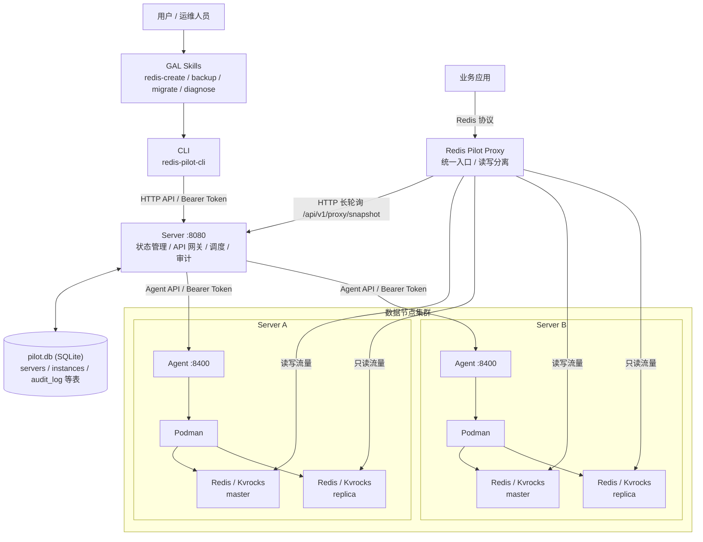

# Redis Pilot

轻量级 Redis/Kvrocks 多实例管理平台。通过 Server + Agent 架构集中管理分布在多台服务器上的 Redis 和 Kvrocks 容器实例，提供创建、主从复制、自动备份、故障转移、读写分离代理等能力，替代手动 SSH 逐台操作的运维方式。

## 特性

- 单点 & 主从实例创建、配置、删除
- 服务器节点化与智能调度（跨可用区分布）
- Redis Pilot Proxy 读写分离
- 自动备份与恢复
- Sentinel 事件监听 + 定期 reconcile 的故障转移同步与状态自愈
- 完整审计日志
- 支持 Redis 5 / 6.2 / 7 和 Apache Kvrocks 2.15.0（版本由 Server 白名单统一管理）

## 架构



管理流量从 GAL Skills/CLI 进入 Server，再由 Server 调度到各节点 Agent 执行 Podman 容器操作；业务流量不经过 Server，直接通过 Redis Pilot Proxy 访问后端 Redis/Kvrocks 实例。Server 是全局状态唯一写入点，状态和审计日志统一存储在 `pilot.db`（SQLite）：`servers` 表记录节点资源和 Agent 连接信息，`instances`/`instance_groups` 表记录实例拓扑、端口、角色和备份配置，`audit_log` 表记录所有管理操作。

| 组件 | 端口 | 职责 |
|------|------|------|
| Server | 8080 | 全局状态管理、API 网关、资源调度 |
| Agent | 8400 | 容器管理、健康检查、备份执行（每台服务器一个） |
| Proxy | 16379+（auto）/ 16500+（master） | 业务 Redis 协议入口，提供统一访问和读写分离 |
| Proxy Metrics | 19100 | Prometheus 指标暴露 |
| CLI | - | 命令行工具，调用 Server API |

## 快速开始

### 编译

```bash
make all
# 产出: bin/redis-server  bin/redis-agent  bin/redis-cli  bin/redis-proxy
# redis-cli 部署时通常安装为 /usr/local/bin/redis-pilot-cli
```

### 启动 Server

```bash
mkdir -p /opt/redis-pilot-server/{state,audit,logs}
cp configs/server.yaml /opt/redis-pilot-server/server.yaml
bin/redis-server --config /opt/redis-pilot-server/server.yaml
```

### 启动 Agent（每台数据节点）

```bash
mkdir -p /opt/redis-pilot-agent/logs /data/redis
cp configs/agent.yaml /opt/redis-pilot-agent/agent.yaml
bin/redis-agent --config /opt/redis-pilot-agent/agent.yaml
```

### 启动 Proxy

```bash
mkdir -p /opt/redis-pilot
cp configs/proxy.yaml.example /opt/redis-pilot/proxy.yaml
# 编辑 proxy.yaml：设置 server_endpoint 指向 Server 地址
bin/redis-proxy -config /opt/redis-pilot/proxy.yaml
```

### 注册服务器 & 创建实例

```bash
# 注册服务器到节点
redis-pilot-cli node add server-a --endpoint 10.0.1.10 --cpu 16 --memory 64Gi

# 创建单点缓存实例
redis-pilot-cli instance create my-cache --group cache --engine redis --memory 2Gi

# 创建主从持久化实例
redis-pilot-cli instance create my-order --group order --engine kvrocks --memory 4Gi --type replication

# 查看状态
redis-pilot-cli instance list
redis-pilot-cli instance status my-cache
```

## 项目结构

```
├── cmd/
│   ├── server/          # Server 入口
│   ├── agent/           # Agent 入口
│   ├── proxy/           # Proxy 入口
│   └── cli/             # CLI 入口
├── internal/
│   ├── server/          # Server: API handler、调度、代理层状态快照
│   ├── proxy/           # Proxy: HTTP 长轮询拉取快照、Redis 读写分离
│   ├── agent/           # Agent: 容器管理、健康检查、配置模板
│   ├── state/           # YAML 状态文件读写 + 文件锁
│   ├── audit/           # 审计日志（JSONL）
│   ├── podman/          # Podman API 封装
│   └── logger/          # 日志
├── pkg/apitypes/        # Server ↔ Agent 共享类型
├── pkg/redisconf/       # config_overrides 校验规则（Server/Agent 共用）
├── configs/             # 配置文件示例
└── docs/                # 文档
```

## 配置

### Server (`server.yaml`)

```yaml
port: 8080
token: ""                    # Bearer Token，空则不鉴权
data_dir: /opt/redis-pilot-server/state
ports:
  redis:          { start: 6379,  end: 6499  }
  proxy_auto:     { start: 16379, end: 16499 }
  proxy_master:   { start: 16500, end: 16619 }
images:
  redis:
    default: "7"
    versions:
      "5": docker.io/redis:5
      "6.2": docker.io/redis:6.2
      "7": docker.io/redis:7
  kvrocks:
    default: "2.15.0"
    versions:
      "2.15.0": docker.io/apache/kvrocks:2.15.0
log:
  dir: /opt/redis-pilot-server/logs
  stdout: true
```

### Proxy (`proxy.yaml`)

```yaml
# Discovery 模式：从 Server 拉取快照，动态驱动 listener 和连接池
server_endpoint: http://127.0.0.1:8080   # Server API 地址
server_token: ""                          # Bearer Token，与 Server 的 token 一致（空=不鉴权）
poll_interval: 2s                         # 两次长轮询请求的最小间隔（长轮询下仅作下限）
poll_timeout: 5s                          # 网络往返余量，不含服务端挂起时长
poll_wait: 20s                            # 长轮询挂起上限，0 关闭长轮询退回定期轮询
metrics_listen: 0.0.0.0:19100             # Prometheus /metrics 地址（空=关闭）
```

Proxy 启动后通过 HTTP 长轮询 `GET /api/v1/proxy/snapshot` 从 Server 拉取代理快照，按快照中的后端实例列表动态调整读写分离路由；业务 Redis 流量直接由 Proxy 处理，不经过 Server。完整配置（含 static 模式与连接池参数）见 `configs/proxy.yaml.example`。

> **安全提示**：proxy snapshot 中包含 Redis 明文密码（用于 Proxy 与后端建立连接）。
> 该快照由 Server 的 `/api/v1/proxy/snapshot` 接口返回。若 Server 未设置 `token` 鉴权，
> 任何能访问 Server 端口的网络主体都可拉取全部密码。生产环境请务必为 Server
> 设置 `token`（并在 `proxy.yaml` 中配置相同的 `server_token`），并将 Server
> 端口限制在可信网段/回环地址。

### Agent (`agent.yaml`)

```yaml
port: 8400
token: ""
data_dir: /data/redis
log:
  dir: /opt/redis-pilot-agent/logs
  stdout: true
```

### CLI (`~/.redis-pilot-cli/config.yaml`)

```yaml
server: 127.0.0.1:8080
token: ""
```

## CLI 命令参考

```bash
# 节点
redis-pilot-cli node list
redis-pilot-cli node add <name> --endpoint <ip> --cpu <cores> --memory <size>
redis-pilot-cli node remove <name>
redis-pilot-cli node update <name> --json <server.json>

# 实例
redis-pilot-cli instance list
redis-pilot-cli instance status <name>
redis-pilot-cli instance create <name> --group <group> [--engine redis|kvrocks] [--memory 2Gi] [--type standalone|replication]
redis-pilot-cli instance delete <name> [--clean-data]
redis-pilot-cli instance start <name>
redis-pilot-cli instance stop <name>
redis-pilot-cli instance config <name> --set key=value[,key=value] [--restart]
# 注：replicaof / requirepass / dir / min-replicas-to-write / rename-command 等
# 由平台管理的配置项不允许覆盖，会返回 400。完整清单见 pkg/redisconf/validate.go
redis-pilot-cli instance replicate <replica> --replica-of <master>

# 故障转移（Sentinel 唯一权威：不保证提升指定的那个实例，最终由 Sentinel 选举决定）
redis-pilot-cli instance failover <name>

# 备份
redis-pilot-cli backup exec <instance>
redis-pilot-cli backup list <instance>
redis-pilot-cli backup restore <instance> --backup-ts <timestamp>
redis-pilot-cli backup set-schedule <instance> --cron "0 2 * * *" --retention 7

# Sentinel
redis-pilot-cli sentinel status
redis-pilot-cli sentinel sync
```

## 文档

- [部署文档](docs/DEPLOYMENT.md) - 完整的生产部署指南
- [架构设计](docs/architecture/overview.md) - 详细设计文档（拆分为 overview / components / flows / deployment-ops 四篇）

## 技术栈

- Go 1.25 / Gin
- Podman（容器运行时）
- Redis Pilot Proxy（自研 Go 读写分离代理）
- YAML（状态存储）
